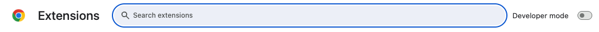
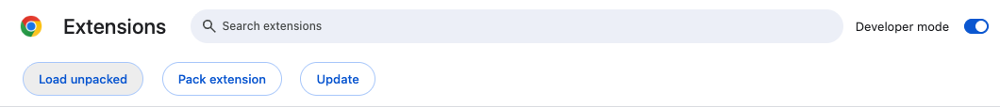
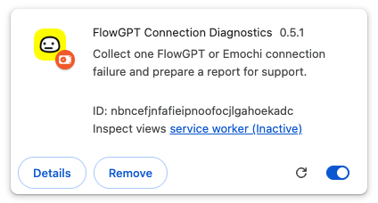
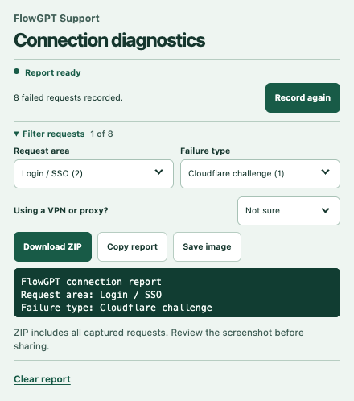

# FlowGPT Diagnostics Guide

Collect a report in desktop Chrome when FlowGPT or Emochi fails to load or sign in.

## Install from source

1. Download and unzip the extension files. Find the folder that contains `manifest.json`.
2. Type `chrome://extensions` in Chrome’s address bar. Turn on **Developer mode** in the top-right corner.

   

3. Click **Load unpacked** and select the folder containing `manifest.json`.

   

4. Check that **FlowGPT Connection Diagnostics** appears and its switch is on.

   

## Run a test

1. Open the affected FlowGPT or Emochi tab. Click the puzzle-piece icon in Chrome’s toolbar, choose **FlowGPT Connection Diagnostics**, and click **Start recording**.
2. Repeat the action that failed in the same tab and on the same network. The panel on the page shows the time left and the number of failed requests.
3. Open the extension again and click **Stop recording**. Use **Filter requests** to find the relevant failure by request area or failure type.
4. With the error still visible, click **Download ZIP**. It includes the selected report, all recorded failures, and a screenshot of the visible page. Review the screenshot and share the ZIP privately with support.

To test another tab, start a separate recording there.
